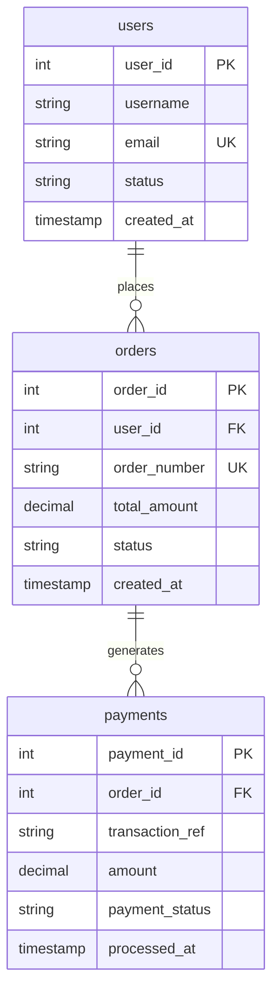

# Database Validation & SQL Test Suite

This module demonstrates **Database-Level Quality Assurance (DB QA)** and data integrity verification for a high-volume e-commerce backend platform. It validates schema constraints, transactional consistency, relational integrity, and financial idempotency using SQL test queries.

---

## 📋 Overview & Objectives

In automated and manual software QA, API and UI validations only verify the surface level. **Database Testing** ensures that:
1. **State Persistence**: User lifecycle states (e.g., `PENDING` -> `ACTIVE`) are correctly transitioned and recorded.
2. **Relational Integrity**: Foreign key references across multi-table relationships (`users` -> `orders` -> `payments`) remain synchronized.
3. **Financial & Transactional Integrity**: No duplicate charges occur for a single order (validates bug triage for [`BUG_SOFT_001`](../bug-reports/BUG_SOFT_001_idempotency.md)).
4. **Data Hygiene & Orphan Detection**: Abandoned checkouts and failed transaction states are tracked without orphaned references.

---

## 🗄️ Database Schema & Entities

The target relational model represents a core checkout pipeline:



---

## 🧪 QA Verification Test Queries

### Test 1: User Account State Verification
- **Objective**: Confirm user registration successfully assigned an `ACTIVE` status to verified accounts.
- **Query**:
  ```sql
  SELECT user_id, username, email, status
  FROM users
  WHERE email = 'alex.qa@example.com';
  ```
- **Expected Result**: Exactly 1 record returned with `status = 'ACTIVE'`.
- **Actual Result**: `(101, 'alex_tester', 'alex.qa@example.com', 'ACTIVE')` — **PASS** ✅

---

### Test 2: Multi-Table Relational Integrity (3-Table JOIN)
- **Objective**: Validate that every `COMPLETED` order has an intact foreign key relationship to an active user and a corresponding payment record.
- **Query**:
  ```sql
  SELECT
      u.username,
      u.email,
      o.order_number,
      o.total_amount AS order_total,
      o.status AS order_status,
      p.transaction_ref,
      p.amount AS amount_paid,
      p.payment_status
  FROM orders o
  JOIN users u ON o.user_id = u.user_id
  JOIN payments p ON o.order_id = p.order_id
  WHERE o.status = 'COMPLETED';
  ```
- **Expected Result**: Complete records for orders `ORD-2026-001` and `ORD-2026-002` matching all user and payment metadata.
- **Actual Result**: 3 rows returned with zero null references — **PASS** ✅

---

### Test 3: Catching Financial Integrity Defects (Duplicate Payments)
- **Objective**: Identify orders that were double-billed due to race conditions or missing idempotency locks.
- **Target Defect**: Cross-verifies [`BUG_SOFT_001_idempotency`](../bug-reports/BUG_SOFT_001_idempotency.md).
- **Query**:
  ```sql
  SELECT
      order_id,
      COUNT(payment_id) AS total_transactions,
      SUM(amount) AS total_billed
  FROM payments
  WHERE payment_status = 'SUCCESS'
  GROUP BY order_id
  HAVING COUNT(payment_id) > 1;
  ```
- **Expected Result**: Detects any order with `COUNT(payment_id) > 1`.
- **Actual Result**: `order_id 5001` returned with 2 successful transactions totaling \$259.98 — **DEFECT CONFIRMED** ⚠️

---

### Test 4: Orphan & Abandoned Record Detection (LEFT JOIN)
- **Objective**: Identify pending orders that have no recorded payment attempts (abandoned checkouts or dropped gateway webhooks).
- **Query**:
  ```sql
  SELECT
      o.order_id,
      o.order_number,
      o.total_amount,
      o.status
  FROM orders o
  LEFT JOIN payments p ON o.order_id = p.order_id
  WHERE p.payment_id IS NULL;
  ```
- **Expected Result**: Returns `order_id 5003` (`ORD-2026-003`, \$250.00, `PENDING`).
- **Actual Result**: Exactly 1 orphaned checkout identified — **PASS** ✅

---

## 🚀 How to Execute the Verification Suite

### Method A: Python One-Liner (Built-in / Automated Runner)
From the `software-qa/database-validation` directory:
```powershell
python -c "import sqlite3; con = sqlite3.connect('qa_lab.db'); con.executescript(open('db_verification_tests.sql').read()); [print(row) for row in con.execute('SELECT * FROM users')]"
```

Or from the repository root:
```powershell
python -c "import sqlite3; con = sqlite3.connect('software-qa/database-validation/qa_lab.db'); con.executescript(open('software-qa/database-validation/db_verification_tests.sql').read()); [print(row) for row in con.execute('SELECT * FROM users')]"
```

### Method B: SQLite3 CLI
```powershell
sqlite3 qa_lab.db < db_verification_tests.sql
```
